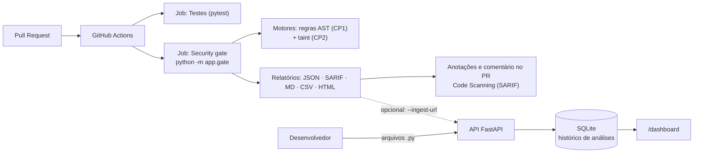

# CP3 — DevSecOps e entrega

A CP3 integra a plataforma ao ciclo de desenvolvimento: um **Security Gate** no GitHub Actions bloqueia Pull Requests inseguros e um **dashboard executivo** mostra os achados por arquivo, linha e severidade. Os motores das CPs anteriores (`app/scanner.py`, `app/taint.py`, `app/semantic.py`, `app/llm.py`) **não foram alterados**.

## Correspondência com o enunciado (slide da CP3)

| Entrega pedida | Implementação | Como demonstrar |
|---|---|---|
| Security Gates em pipelines CI/CD (GitHub Actions) para bloquear PRs inseguros | `app/gate.py` (CLI com código de saída) + `.github/workflows/security-gate.yml` | Abrir um PR com código vulnerável: o job "Security gate" fica vermelho e o merge é bloqueado |
| Dashboard executivo por arquivo, linha e severidade | `app/static/dashboard.html`, servido em `GET /dashboard`; histórico em SQLite (`app/storage.py`) | http://localhost:8000/dashboard |
| Relatórios analíticos | `app/reports.py`: JSON, CSV, Markdown, SARIF 2.1.0 e HTML autônomo | Botões de exportação do dashboard ou `GET /reports/{id}.{json,csv,md,sarif,html}` |
| Refinamento da experiência do usuário | Anotações inline no PR, comentário automático, filtros clicáveis, detalhe com caminho dos dados e correção | Ver roteiro em [DEFESA_CP3.md](DEFESA_CP3.md) |
| Documentação técnica e defesa | Este arquivo, [DEFESA_CP3.md](DEFESA_CP3.md) e [arquitetura-c4.md](arquitetura-c4.md) | — |

## Arquitetura



O gate usa **apenas os motores determinísticos**. O Ollama não participa do pipeline: o veredito de um PR precisa ser reproduzível e não pode falhar por indisponibilidade de um modelo. A revisão por IA continua disponível em `POST /scan/semantic`.

## Security Gate

```bash
python -m app.gate --path . --changed-from origin/main --fail-on HIGH \
  --json-out reports/gate.json --sarif-out reports/gate.sarif --markdown-out reports/gate.md
```

| Código de saída | Significado |
|---|---|
| `0` | Aprovado |
| `1` | **Bloqueado** pela política (é isto que torna o check do PR vermelho) |
| `2` | Erro de uso ou configuração (pasta inexistente, TOML inválido, `fail_on` desconhecido) |

Opções principais: `--path`, `--config`, `--project`, `--changed-from REF`, `--fail-on {INFO,LOW,MEDIUM,HIGH,CRITICAL,NONE}`, `--exclude GLOB` (repetível), `--json-out`, `--sarif-out`, `--markdown-out`, `--csv-out`, `--html-out`, `--ingest-url`, `--no-annotations`.

**Em Pull Requests** o workflow passa `--changed-from origin/<base>`: só os `.py` adicionados/modificados no PR são analisados, então dívida antiga não bloqueia mudanças não relacionadas. Em `push` na `main` o projeto inteiro é analisado. Se o `git diff` falhar, o gate analisa tudo (falha para o lado seguro) e avisa em stderr.

### Política (`sast-gate.toml`)

```toml
[policy]
fail_on = "HIGH"              # bloqueia a partir desta severidade efetiva
fail_on_parse_error = false   # true: arquivo com erro de sintaxe também bloqueia
# max_active_findings = 10    # opcional: teto de achados ativos, em qualquer severidade

[scan]
exclude = [".git/**", ".venv/**", "venv/**", "node_modules/**", "__pycache__/**", "reports/**", "samples/**"]
```

`samples/` fica excluída porque contém código vulnerável de propósito (material de demonstração). Para demonstrar um bloqueio: `python -m app.gate --path samples`.

### Severidade efetiva

O gate decide pela **severidade efetiva**, derivada da estática: um fluxo de taint cuja única origem é um **parâmetro de função assumido como externo** (confiança `MEDIUM`) e que não coincide com uma regra de padrão perigoso (`eval`, `shell=True`…) desce um nível, por ser o caso mais sujeito a falso positivo. Exemplo: `def f(p): cursor.execute("S" + p)` é `HIGH` estático e `MEDIUM` efetivo. A severidade estática original nunca é apagada: aparece no relatório e no detalhe de cada achado.

### Supressões auditáveis

Um falso positivo confirmado por uma pessoa pode ser suprimido na própria linha:

```python
resultado = eval(expressao)  # sast-ignore: SAST002 -- expressão vem de lista fixa validada
```

`# sast-ignore` sem regra suprime todas as regras da linha. O achado **continua no relatório** (`suppressed: true`, com o motivo, e `suppressions` no SARIF); apenas deixa de bloquear. Isso mantém a decisão visível em code review.

### Identidade do achado

Cada achado tem um `fingerprint` (hash de regra + arquivo + texto da linha normalizado), estável quando a linha muda de posição. É usado como `partialFingerprints` no SARIF para o GitHub acompanhar o mesmo alerta entre commits.

## Workflow `.github/workflows/security-gate.yml`

| Job | O que faz |
|---|---|
| `Testes` | `pytest` em Python 3.12 |
| `Security gate` | Roda o gate; publica artefato `sast-reports`; envia SARIF ao Code Scanning; cria/atualiza **um** comentário no PR; escreve o resumo do job; emite anotações `::error` nas linhas vulneráveis (aba *Files changed*) |
| `Build da imagem` | `docker build` para garantir que a imagem continua construindo |

Detalhes de segurança do workflow: permissões mínimas (`contents: read`; `security-events` e `pull-requests: write` apenas no job do gate); o nome da branch base chega ao script por variável de ambiente (nunca interpolado direto no shell); em PRs vindos de forks, onde o token é somente leitura, SARIF e comentário são pulados e o gate roda normalmente. As ações usam tags de versão maior (`@v6`, `@v4`, `@v8`); o `dependabot.yml` incluído propõe atualizações semanais. Confira as versões no momento de enviar.

### Ativar o bloqueio de merge

O workflow só **reprova o check**; quem impede o merge é a proteção da branch. No GitHub: **Settings → Branches → Add branch ruleset** (ou *branch protection rule*) para `main` → marcar **Require a pull request before merging** e **Require status checks to pass** → adicionar os checks **Testes** e **Security gate** (eles só aparecem na lista depois de rodarem uma vez). Sem esse passo, um PR vermelho ainda pode ser mesclado por quem tiver permissão.

### Alimentar o dashboard a partir do CI (opcional)

O dashboard roda na máquina do grupo (`localhost`), que o GitHub não alcança. Por isso o artefato `dashboard.html` do workflow (dashboard completo, em um arquivo, funciona offline) é o caminho padrão. Se a API estiver hospedada em uma URL acessível, defina os *secrets* `SAST_API_URL` (e `SAST_API_TOKEN`, igual ao `SAST_INGEST_TOKEN` da API) e cada execução também será gravada no histórico. Falhas de envio são apenas avisos: nunca alteram o veredito.

## Dashboard executivo

Abra http://localhost:8000/dashboard. Conteúdo:

- **Faixa de veredito**: "Merge bloqueado" ou "Aprovado pelo gate", com o motivo, projeto, branch/commit, origem e total de achados ativos.
- **Severidade**: barra única proporcional; clique para filtrar.
- **Arquivos com achados**: barras segmentadas por severidade; clique para filtrar.
- **Tipos de falha (CWE)** e **histórico de análises** (cada coluna é uma análise; vermelho = bloqueada, verde = aprovada; clique para abrir).
- **Tabela por arquivo e linha** com busca, filtros, ordenação e linhas expansíveis: caminho dos dados (origem → propagação → destino), explicação e exemplo de correção.
- **Nova análise**: envie arquivos `.py` ou uma pasta; eles são analisados como texto, nunca executados.

A interface não usa bibliotecas nem fontes externas, tem política CSP restritiva, todo texto é inserido via DOM (sem `innerHTML`) e funciona em telas pequenas. Mantenha esses cuidados ao editá-la, pois os dados podem vir de relatórios ingeridos.

## API da CP3

| Endpoint | Função |
|---|---|
| `GET /dashboard` | Página do dashboard |
| `GET /api/dashboard?project=&scan_id=` | Dados do painel (análise escolhida ou a mais recente + histórico) |
| `GET /api/scans?project=&limit=` | Histórico resumido |
| `POST /scan/project` | Analisa vários arquivos enviados em JSON, aplica a política, salva (`save=false` não salva) |
| `POST /api/scans/ingest` | Recebe o relatório JSON do gate (formato `sast-report/1`) |
| `GET /reports/{id}.{json,csv,md,sarif,html}` | Exportações |

O `/api/scans/ingest` valida cada campo (tipos, enums, tamanhos), **recalcula resumo e veredito no servidor** e, se `SAST_INGEST_TOKEN` estiver definido, exige `Authorization: Bearer`. CSV neutraliza fórmulas (`=`, `+`, `-`, `@`) para planilhas.

## Como executar

```bash
docker compose up --build -d        # API + Ollama; o histórico fica no volume sast-data
# http://localhost:8000/dashboard  e  http://localhost:8000/docs
docker compose exec sast-api python -m pytest -q -p no:cacheprovider
docker compose exec sast-api python -m app.gate --path . --html-out reports/dashboard.html
```

Sem Docker: `pip install -r requirements.txt`, `python -m app.gate --path .` e `uvicorn app.main:app` (o histórico fica em `data/sast.db`; `SAST_DB_PATH` muda o local).

## Mudanças sobre a CP2

Novos: `app/project_scan.py`, `app/gate.py`, `app/reports.py`, `app/storage.py`, `app/dashboard.py`, `app/static/dashboard.html`, `sast-gate.toml`, `.github/workflows/security-gate.yml`, `.github/dependabot.yml`, `.env.example`, `tests/test_cp3.py`, esta documentação. Modificados: `app/main.py` (inclui o router, versão 0.3.0), `compose.yaml` (volume `sast-data`, variáveis), `Dockerfile` (diretório de dados com permissão do usuário não-root), `.gitignore`, `.dockerignore`, `README.md`.

**Decisão de arquitetura:** o diagrama C4 da CP1 previa PostgreSQL, Redis/Celery e fila assíncrona. Para a entrega usamos **SQLite** (biblioteca padrão, sem serviço extra, adequado ao volume do protótipo) e varredura síncrona; uma varredura de 500 arquivos de ~240 linhas levou cerca de 3 s no ambiente de preparação, tempo aceitável para o uso didático sem fila. Trocar `app/storage.py` por PostgreSQL é uma mudança localizada.

## Testes e evidências

`python -m pytest -q -p no:cacheprovider` → **118 testes** (55 das CPs 1 e 2, 63 novos). A CP3 cobre: limiares e política, severidade efetiva, supressões, exclusões, SARIF/CSV/Markdown/HTML, CLI (códigos de saída, TOML, anotações, resumo do job), `git diff` real em repositório temporário, persistência, endpoints, validação da ingestão (inclusive tentativa de forjar aprovação e token) e um teste de que **o próprio repositório passa no seu gate**.

## Limitações

- Cobertura limitada aos motores existentes: só Python, quatro classes de falha (CWE-78, 89, 95, 798), análise intraprocedural. Veja [CP2.md](CP2.md). **Gate aprovado não significa código seguro.**
- A severidade efetiva é uma heurística do projeto, não um padrão (não é CVSS).
- O dashboard e a API **não têm autenticação** (só o ingest aceita token). Rode em `localhost`, como no Compose. Não exponha na internet sem um proxy autenticado.
- O histórico guarda os relatórios completos, que incluem trechos de correção, mas **não o código-fonte**. Mantém as 1.000 análises mais recentes.
- Escritas simultâneas em SQLite são serializadas; suficiente para o uso previsto, não para alto volume.
- Não verificado neste pacote: execução real do workflow no GitHub (testamos a lógica do script localmente), `docker compose build` e inferência real do Llama (herdado da CP2). Veja o roteiro de validação em [DEFESA_CP3.md](DEFESA_CP3.md).
