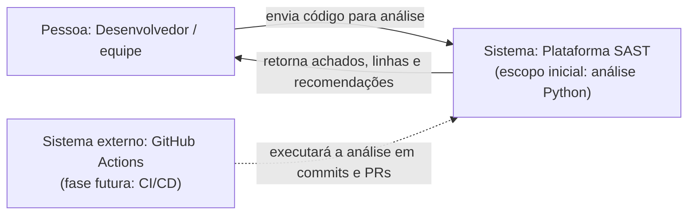
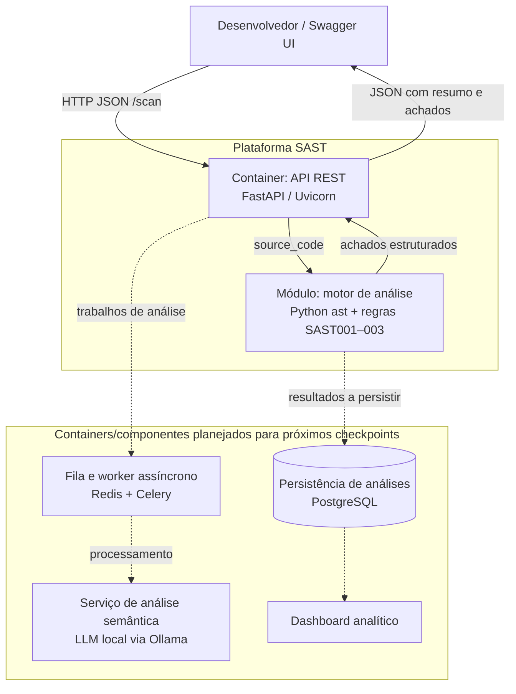

# Diagrama de arquitetura — C4

Os diagramas usam Mermaid para que possam ser visualizados no GitHub e em editores compatíveis. O primeiro descreve o contexto (C4 nível 1) e o segundo os containers (C4 nível 2). Componentes marcados como futuros fazem parte da visão-alvo do projeto, mas ainda não estão implementados no CP1.

## C4 — Nível 1: Contexto do sistema

## C4 — Nível 2: Containers

## Responsabilidades no CP1

- **FastAPI:** recebe código por HTTP, valida a requisição e entrega um relatório JSON.
- **Motor AST:** faz parsing sintático e aplica as três regras determinísticas iniciais.
- **Docker Compose:** constrói e inicia o container da API para desenvolvimento e demonstração.
- **Testes:** verificam detecções positivas, caso sem os padrões, código com sintaxe inválida e endpoints da API.

PostgreSQL, Redis/Celery, Ollama, dashboard e pipeline CI/CD são componentes planejados; o diagrama não afirma que já estejam funcionais no CP1.
